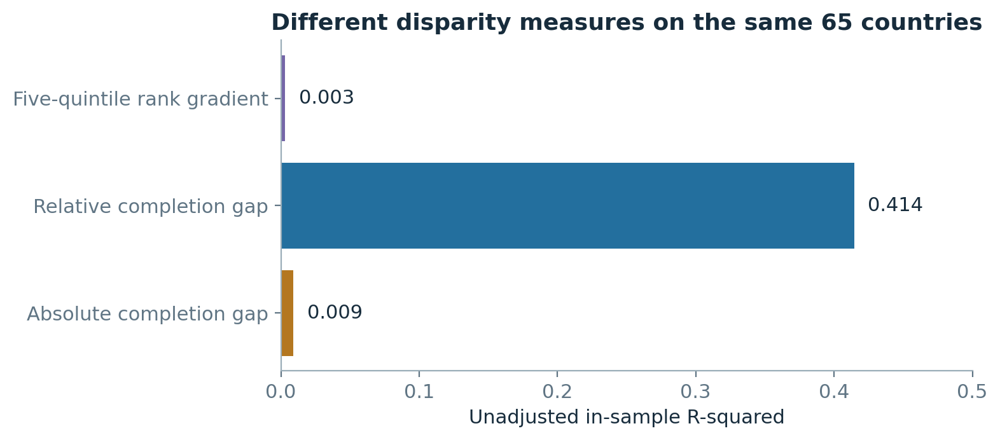
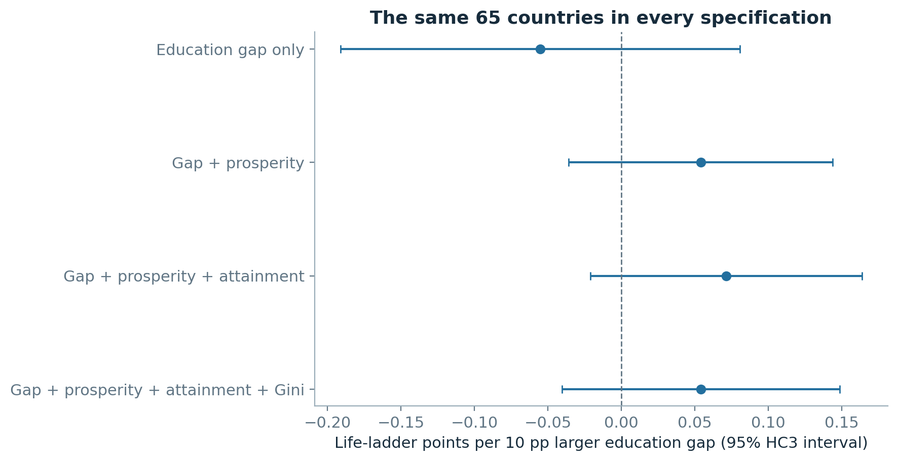
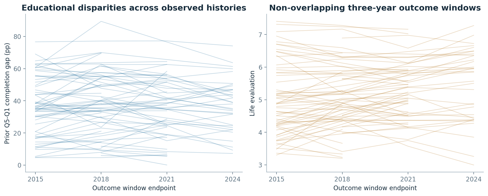
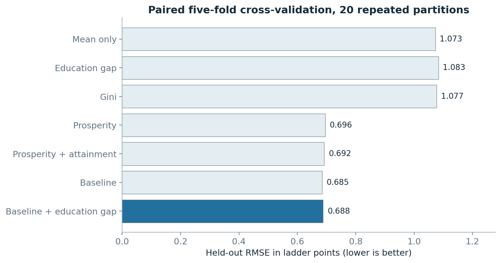
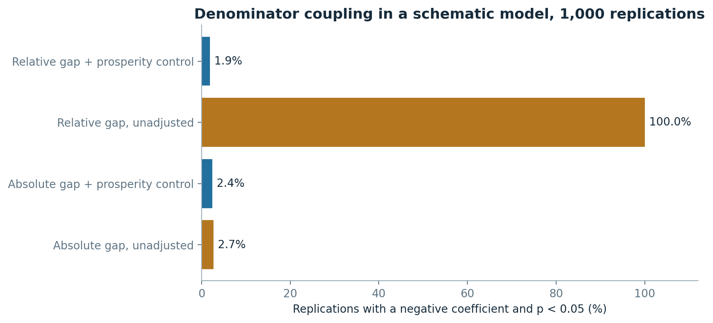

# Education Disparities and National Life Evaluation

## Measurement, prosperity adjustment and evidence within countries

Mobin Seyedmohammadi · Independent research draft · 12 November 2026

## Abstract

This study asks whether socioeconomic disparities in upper-secondary completion contain information about national life evaluation beyond prosperity and average educational attainment. It compares three clearly defined completion-disparity measures, estimates conditional cross-sectional and within-country associations, and evaluates prediction for held-out countries using public education, wellbeing and macroeconomic data.

The primary measure pairs upper-secondary completion in the highest and lowest socioeconomic quintiles within a single survey. In 65 recent complete-case countries, its adjusted coefficient is 0.054 life-ladder points per 10 percentage-point larger gap, with interval [-0.040, 0.148]. A longitudinal analysis matches education to subsequent, non-overlapping life-evaluation windows and retains 198 observations across 70 countries. The country- and period-effects estimate is 0.008, with a country-clustered interval of [-0.103, 0.119]. Adding the gap changes repeated held-out RMSE from 0.685 to 0.688.

The estimates provide limited evidence of an independent association between the measured completion gap and life evaluation in these observed samples. Absolute and relative measures produce different unconditional patterns, and adding the absolute gap yields little stable predictive gain. These results do not identify causal effects or establish that educational equality has no social value. A schematic simulation illustrates how attainment in a relative measure's denominator can connect it to prosperity.

Keywords: educational disparities, life evaluation, measurement, panel data, robust inference, predictive validation

All substantive analyses are exploratory. The study is observational and was not preregistered.

## 1. Motivation and contribution

Educational disparities and the distribution of economic resources are plausible correlates of subjective wellbeing. Yet the question “which inequality matters more?” mixes several distinct tasks. A measure must first represent a defensible concept. A regression must then separate its association from other country attributes. A predictor must finally improve performance on observations that did not determine its fitted parameters. Comparing two unadjusted R-squared values answers only a narrow version of the second task.

Educational disparity and educational scarcity are different concepts. Countries can have the same national completion rate but different gaps between socioeconomic groups. Absolute and relative gap definitions can also tell different stories when overall completion differs. A study of wellbeing must therefore examine both the definition of disparity and its relationship with prosperity and average attainment.

The research questions are whether a same-survey socioeconomic completion gap contains additional information about life evaluation, whether the answer depends on the definition of disparity, and whether within-country comparisons and held-out predictions support a similar interpretation. The analysis uses a recent cross section and an unbalanced country panel with education observed before disjoint wellbeing windows. Source records, inclusion decisions and numerical outputs remain inspectable.

## Relationship to existing research

Research on educational inequality distinguishes attainment, achievement and opportunity. Thomas, Wang and Fan [1] construct inequality measures using schooling attainment. Ferreira and Gignoux [2] show why educational measurement and the population covered by a survey matter, and distinguish achievement dispersion from inequality associated with predetermined circumstances. The present SES completion gaps are narrower than either a full education distribution or a formal opportunity decomposition.

Oishi, Kesebir and Diener [3], and Oishi and Kesebir [4], examine income inequality and wellbeing in settings that differ from this project’s recent cross section. Their results motivate investigation but cannot validate a coefficient in a different design. The World Happiness Report provides both the life-evaluation source and an established empirical reason to account for prosperity [5]. The OECD/JRC guidance on composite indicators [6] motivates checking choices of normalization, weighting and missing-data treatment. Country-level longitudinal comparisons draw on the distinction between within-unit and between-unit information associated with Mundlak [7].

The contribution is an integrated empirical study of measurement, conditional association and prediction. It combines transparent survey pairing, dependence-aware inference, a complete sensitivity grid and an explicit comparison of training fit with held-out prediction. The analysis is designed to show both the information these aggregate sources contain and the limits of what they can establish.

## 2. Data and population under study

| Source | Variables used | Role |
| --- | --- | --- |
| UNESCO GEM/UIS WIDE [8] | Completion rates, SES quintiles, national totals, survey/year, sample counts | Build same-survey education gaps |
| World Happiness Report 2025 figure data [5] | Cantril Ladder averages and reported intervals | Country life evaluation, not emotional affect |
| World Bank WDI [9] | SI.POV.GINI | Observed income/consumption inequality |
| World Bank WDI [10] | NY.GDP.PCAP.PP.KD | Actual real PPP GDP per person |

The WIDE, Gini and happiness data are archived public-source snapshots whose historical extraction dates are unknown. The GDP responses were downloaded on 12 November 2026, with API metadata reporting a last update of 11 November 2026. This is a retrospective analysis using revised macroeconomic data rather than historical real-time forecast inputs. Exact source files, URLs and hashes are bundled. WIDE is stored in losslessly compressed form, with the uncompressed source hash retained in the manifest.

The WHR workbook is Figure 2.1 data. Its “Year” label identifies the endpoint of a reporting window. Endpoint 2024 represents 2022-2024, rather than an annual 2024 wave. Columns labelled “Explained by” are model contributions. They are not used as raw GDP, social support or other original covariates. Cross-sectional regressions use actual World Bank GDP instead.

## Sample construction

| Cross-sectional step | Countries |
| --- | --- |
| WHR outcome at endpoint 2024 | 147 |
| WIDE countries with a valid 2015-2021 paired survey | 87 |
| WHR countries with an eligible education observation | 70 |
| Also observed Gini in 2015-2024 and three-year GDP | 65 |

Country names are reconciled with explicit ISO3 mappings. Fuzzy matching is prohibited. Northern Cyprus and Somaliland are separate outcome sampling territories and are not reassigned to Cyprus or Somalia. At the measurement key, identical point estimates collapse. A country-survey-year is excluded if any required quintile or national completion estimate conflicts. This flags seven ambiguous surveys rather than silently averaging the contradictions. Every exclusion remains in a country or country-period audit.

The observed cross-sectional sample is selective: included countries average 5.32 life-ladder points, compared with 5.78 among excluded outcome countries. Only seven high-income countries enter the cross section. Complete-case analysis exposes this selection; it does not remove it. Estimates therefore refer to the observed sample rather than all countries or the world population.

## 3. Measuring socioeconomic educational disparity

The primary exposure uses WIDE’s upper-secondary completion series `comp_upsec_v2_m`, distinct from its age-20-29 completion series. Within a single country-survey-year, p1 and p5 denote the completion proportions for the lowest and highest socioeconomic quintiles. “Socioeconomic” is deliberate: WIDE’s wealth grouping can derive from assets, income, consumption or other source-specific definitions [8]. It is not a uniform international wealth scale.

`Absolute gap D = 100(p5 - p1) percentage points; regression exposure = D / 10`

`Relative gap R = (p5 - p1) / [(p5 + p1)/2]`

A 10-point gap between completion rates of 10% and 20% has relative gap 0.667. The same absolute gap between 80% and 90% has relative gap 0.118. Relative disparity emphasizes proportional shortfalls where completion is scarce. Absolute disparity represents unequal percentage-point attainment. Neither measure is universally preferable, and comparing them changes the scientific question.

Figure 1. Each bar uses the same 65 countries and life-evaluation outcome. Large differences in unconditional fit reflect distinct measures, not a change in the compared population.

In the cross section, the relative gap correlates -0.944 with national completion. Its denominator connects disparity to educational scarcity. The absolute gap has much weaker correlation with national completion. The five-quintile alternative uses fixed rank scores of 0.1, 0.3, 0.5, 0.7 and 0.9. Target-age-group population shares are unavailable, so this is a descriptive rank gradient rather than a population slope index of inequality.

## 4. Empirical design and estimands

## Cross-sectional association

`L_i = a + b D_i/10 + c log(GDP_i) + d Completion_i/10 + e Gini_i/10 + u_i`

The outcome is 2022-2024 life evaluation. Education is the latest valid 2015-2021 survey. Gini is the most recent actual observation in 2015-2024. GDP is the mean of annual natural logs of real PPP GDP per person across all three outcome years, requiring complete coverage. Each country receives equal regression weight. The coefficient b is a conditional linear association in this observed sample, not the response to an education policy. The same 65 countries enter the nested comparisons.

HC3 covariance and a t reference with n-k degrees of freedom provide the main cross-sectional intervals [11]. Countries are the resampling units in 2,000 paired bootstrap draws. Partial R-squared compares the residual fit contribution of education with that of Gini after the other model terms. Direct bootstrap differences replace the incorrect practice of comparing two separate intervals. Diagnostics inspect residual shape, leverage, influence and a limited functional-form test without treating non-rejection as proof of assumptions.

## Longitudinal association

| Prior education survey block | Subsequent life-evaluation window |
| --- | --- |
| 2010-2012 | 2013-2015 |
| 2013-2015 | 2016-2018 |
| 2016-2018 | 2019-2021 |
| 2019-2021 | 2022-2024 |

`L_it = country_i + period_t + b_w D_it/10 + c_w log(GDP_it) + d_w Completion_it/10 + u_it`

Education is 1-3 years before the start of its outcome window, and no education survey appears in more than one period. Countries must contribute at least two complete observations. Country intercepts absorb stable additive differences, and period intercepts absorb a common shift in each outcome block. Inference clusters by country, with CRV1 finite-sample correction and a t reference based on G-1 degrees of freedom [12]. A second 2,000-draw bootstrap resamples entire country histories. These are aggregate associations, not a treatment-based difference-in-differences design.

The analysis is exploratory and its recorded decisions are not a preregistration. Data-informed choices and internal cross-validation do not provide an untouched external test set. All documented specifications are reported rather than selecting a statistically attractive subset.

## 5. Cross-sectional evidence

| Model, same 65 countries | Coefficient | 95% HC3 interval | R² |
| --- | --- | --- | --- |
| Education gap only | -0.055 | [-0.191, 0.081] | 0.009 |
| Gini only | 0.250 | [-0.132, 0.632] | 0.027 |
| Gap + prosperity | 0.054 | [-0.036, 0.144] | 0.600 |
| Gap + prosperity + attainment | 0.071 | [-0.021, 0.164] | 0.622 |
| Gap + prosperity + attainment + Gini | 0.054 | [-0.040, 0.148] | 0.646 |

The Gini-only row uses a 10-point Gini increment. All other rows use a 10 percentage-point education-gap increment. Their coefficient magnitudes are therefore not directly comparable. Model R-squared refers to the entire specification, not the fraction of happiness caused by the included inequality measure.

Figure 2. Education-gap estimates over the model sequence. The confidence intervals use HC3 covariance and t references. Every estimate refers to the same countries.

The full model estimates 0.054 life-ladder points per 10 pp larger gap, with interval [-0.040, 0.148] and p=0.256. The education partial R-squared is 0.021, compared with 0.063 for Gini. The paired bootstrap interval for their partial-R-squared difference spans both signs. These results provide no stable basis for ranking education disparity as the stronger independent predictor in this sample.

The uncertain coefficient does not establish a zero relationship or a positive benefit from disparity. The relative gap has a substantially stronger unconditional association than the absolute gap, but it is also closely connected to overall attainment. The measures capture distinct aspects of educational disparity and should not be treated as interchangeable.

## 6. Evidence from changes within countries

The disjoint-window construction yields 226 complete country-periods across 98 countries. Restricting to countries with repeated information retains 198 observations across 70 countries. Thirty contribute two periods, 22 contribute three and 18 contribute all four. This is an unbalanced repeated-country panel. It does not follow the same people over time.

| Specification | Countries / rows | Gap coefficient | 95% clustered interval |
| --- | --- | --- | --- |
| Pooled + period indicators | 70 / 198 | 0.078 | [0.008, 0.148] |
| Country + period effects | 70 / 198 | 0.008 | [-0.103, 0.119] |
| Same survey source within country | 33 / 85 | -0.057 | [-0.201, 0.088] |
| Balanced four-period countries | 18 / 72 | -0.043 | [-0.250, 0.163] |
| Gini-complete rows, no Gini control | 45 / 123 | 0.037 | [-0.169, 0.243] |
| Gini-complete rows, add Gini | 45 / 123 | 0.080 | [-0.081, 0.240] |
| Five-quintile gradient | 70 / 198 | 0.007 | [-0.084, 0.098] |
| Quadratic completion control | 70 / 198 | -0.018 | [-0.156, 0.120] |
| Adjacent-period first differences | 57 / 103 | -0.005 | [-0.087, 0.077] |

The five-quintile row uses its own rank-gradient increment. First differences use changes in the 10 pp gap and retain adjacent periods only. Other rows use the absolute gap. Intervals cluster by country with G-1 reference degrees of freedom; the small balanced-panel comparison has only 18 countries and correspondingly fragile large-cluster justification.

The main country- and period-effects estimate is 0.008, with clustered interval [-0.103, 0.119] and p=0.882. The country-history bootstrap interval is [-0.076, 0.095]. Leaving out one country at a time yields coefficients from -0.005 to 0.030. These estimates do not reveal a precise negative association between measured disparity changes and later life evaluation.

Source-stable countries, balanced countries and Gini-complete histories are different selected samples. Estimating with and without Gini on the same 123 observations makes the adjustment comparison interpretable within that selected panel. None of the specifications turns a changing SES completion measure into an exogenous intervention.

## 7. Identifying variation and population coverage

Figure 3. Individual country histories use only observed eligible periods. The education measurement always precedes its matched outcome window. The lines do not represent annual interpolation.

| Variable | Overall SD | Within-country SD | Within share of variance |
| --- | --- | --- | --- |
| Education gap, per 10 pp | 1.845 | 0.680 | 13.6% |
| Log real PPP GDP/person | 0.954 | 0.075 | 0.6% |
| Completion, per 10 pp | 2.859 | 0.446 | 2.4% |
| Life evaluation | 1.022 | 0.309 | 9.1% |

These quantities describe where information comes from. They are not reliability ratios. Education and prosperity contain much less variation within countries than across them. Fixed effects remove stable differences but can make measurement error more consequential when true changes are small. The panel’s overall R-squared is 0.920 because country intercepts absorb persistent differences; its within R-squared is 0.119. Reporting the former as education’s explanatory contribution would be misleading.

Requiring prior education and subsequent wellbeing windows also narrows coverage in recent periods. Complete rows decline from 78 in the first outcome window to 37 in the last. Missingness is a characteristic of the source architecture and sampling populations. A balanced-panel restriction changes which countries the analysis describes rather than repairing all selection bias.

## 8. Predictive value for held-out countries

A predictor comparison should evaluate observations outside the estimation fold. The cross-sectional models therefore use five common folds repeated over 20 deterministic partitions. No imputer, scaler or PCA is fitted to the full sample: the primary gap is fixed arithmetic from the source records. All regression parameters are estimated using training countries only. The outcome scale remains the Cantril Ladder.

Figure 4. Mean out-of-fold RMSE over 20 repeated five-fold partitions. Labels report complete out-of-fold errors for each repetition before averaging. Split variability is not a sampling confidence interval.

| Model | Repeated-CV RMSE | MAE |
| --- | --- | --- |
| Mean only | 1.073 | 0.934 |
| Prosperity | 0.696 | 0.545 |
| Baseline | 0.685 | 0.536 |
| Baseline + education gap | 0.688 | 0.540 |

Adding the education gap to prosperity, attainment and Gini changes RMSE by 0.0035 ladder points on average. It improves the score in 7 of 20 partitions and worsens it in the rest. This supports a practical conclusion of little stable incremental gain in this evaluation, rather than a formal proof of predictive equivalence. Analytic leave-one-out predictions produce the same qualitative comparison. Hold-one-region-out results remain available as a separate transport stress test.

These predictions address countries represented by the observed sampling process. They are not forecasts for future years. Repeated evaluation on a dataset that also informs research choices can be optimistic, and an external holdout would be required for stronger generalization claims.

## 9. Sensitivity, diagnostics and multiplicity

| Cross-sectional design check | n | Gap coefficient | 95% HC3 interval |
| --- | --- | --- | --- |
| Primary specification | 65 | 0.054 | [-0.040, 0.148] |
| Education surveys from 2010 onward | 79 | 0.040 | [-0.036, 0.117] |
| Education surveys from 2018 onward | 48 | -0.006 | [-0.103, 0.092] |
| Gini observations from 2020 onward | 47 | 0.040 | [-0.075, 0.154] |
| DHS or MICS surveys only | 38 | 0.049 | [-0.098, 0.195] |
| Reported Q1 and Q5 n >= 100 | 34 | 0.003 | [-0.173, 0.179] |
| Exclude Cook-flagged countries | 59 | 0.051 | [-0.035, 0.138] |
| Allow quadratic log prosperity | 65 | 0.062 | [-0.048, 0.172] |
| Allow quadratic completion | 65 | 0.110 | [-0.028, 0.248] |
| Adjust for education survey age | 65 | 0.048 | [-0.048, 0.145] |
| Region indicators, non-singleton regions | 64 | -0.001 | [-0.091, 0.089] |

The region-indicator check excludes singleton regions before fitting, because a singleton fixed-effect cell has leverage one and invalidates the usual HC3 residual correction. This removes the sole Oceania country for that check. Excluding Cook-flagged countries is reported as a sensitivity result and never replaces the main sample. Requiring reported Q1 and Q5 sample sizes reduces coverage because counts are missing for some sources; it is not a survey-design correction.

The main cross-sectional diagnostic results are Breusch-Pagan p=0.765, an HC3 quadratic RESET check p=0.245, and maximum VIF=3.25. These tests do not establish homoskedasticity, linearity or exogeneity. HC3 remains the main covariance choice regardless of those diagnostic p-values. The package includes residual plots, influence values and an algebraic check of the added-variable slope.

The exploratory grid reports all 18 combinations of three education measures, three adjustment sets and two recency samples. Appendix B shows them in design order, with coefficients scaled over each exposure’s interquartile range. Holm-adjusted p-values across that family remain in the tables. This prevents selectively showing an attractive specification, but it does not convert a retrospective analysis into a confirmatory one. Percentile intervals for partial R-squared near its zero boundary are treated as descriptive.

## 10. A simulation of denominator coupling

A schematic experiment isolates a mechanism that is otherwise difficult to see in the empirical comparison. Generate standardized prosperity z, national completion midpoint m=0.2+0.6 logistic(z), and an absolute completion gap d drawn independently from Uniform(0.04,0.16). Set Q1=m-d/2 and Q5=m+d/2. Life evaluation is 5+0.9z plus independent normal noise with standard deviation 0.7. All completion rates remain between zero and one.

`R = d/m;    life evaluation = 5 + 0.9z + noise;    d independent of z and noise`

Figure 5. One thousand replications, each with 150 simulated countries. The event is a negative coefficient with p below 0.05. The real datasets do not determine these simulation parameters.

The relative gap has a negative unconditional relationship with life evaluation in every replication, even though the generated absolute disparity is independent of prosperity and outcome noise. Controlling for prosperity removes that systematic detection pattern. The unadjusted relative association is real in this simulated population; calling it a false rejection of zero association would be incorrect. The mistaken step would be interpreting it as an effect of unequal education.

This experiment does not show that the real data follow this DGP, invalidate relative inequality as a normative concept, or identify the empirical causal mechanism. Its purpose is narrower: demonstrate why normalizing by attainment can connect an inequality measure to development, and why the chosen ruler should be part of the research question.

## 11. Limits of the evidence

## Identification and interpretation

The design does not isolate an intervention. Prosperity, institutions, educational completion and wellbeing may influence one another over long periods. GDP and attainment can be confounders, mediators, outcomes of shared causes or proxies. Their inclusion defines a conditional association rather than uniquely identifying a causal effect. Country effects absorb stable additive attributes but leave time-varying confounders, heterogeneous trends and reverse channels unresolved.

## Measurement and comparability

WIDE combines instruments and source-specific SES rankings. Same-survey pairing prevents a direct mismatch of Q1 and Q5, but does not harmonize what household status means across countries. Even the same survey name can change definitions across waves. National completion and SES gaps refer to young people, while national life evaluation summarizes adults. The ecological relationship cannot establish how an individual’s education or background changes their wellbeing. Sampling uncertainty from complex household designs is not fully available in these aggregate records. Country bootstraps therefore condition on the observed education estimates.

## Selection, dependence and precision

Coverage omits many high-income countries and changes across periods. Missingness may depend on relevant outcomes and institutions. Complete-case estimates and balanced-panel checks do not identify the resulting selection bias. Cross-sectional HC3 assumes independence across countries. Country clustering permits within-country dependence but still assumes sufficient independence between countries after modeled terms. Regional shocks can violate that assumption, and four periods provide too little information for an automatic time-cluster solution. The balanced comparison has few country clusters.

## Multiplicity and generalization

The project began with known original results and evolved after inspection. All estimates are exploratory. The complete specification grid and explicit decision log reduce selective reporting, but cannot erase analytical discretion. Cross-validation reuses the same country pool and does not evaluate an untouched external population. A lack of stable predictive improvement does not establish universal equivalence. Intervals including zero do not prove zero effects, and no post hoc equivalence margin is selected.

## Data vintage

Original extraction dates remain unknown, while the new GDP snapshot includes retrospective revisions. Disjoint outcome windows prevent overlapping-year averages from mechanically reusing the same calendar years, but observations can still share persistent country shocks. Results describe these frozen inputs and harmonization rules. Updated data or more comparable microdata could change the estimates.

## 12. Interpretation and further research

The recent cross section, country panel and held-out predictions provide limited evidence that the measured absolute completion gap adds independent information about national life evaluation beyond the stated model terms. A five-quintile gradient gives a similar interpretation. Relative disparity has a stronger unconditional association, emphasizing the importance of its connection to overall completion and prosperity.

The appropriate substantive conclusion is that these aggregate data and designs provide limited evidence for an independent relationship between the measured completion gap and national life evaluation. They do not imply that educational equality is unimportant or justify prioritizing one redistributive policy over another. A wellbeing coefficient is also not a complete valuation of education as a social objective.

The most useful next investment is stronger measurement. Comparable repeated household or student microdata would permit a stable socioeconomic ranking, correct population weights, survey-design uncertainty and a closer match between educational circumstances and individual outcomes. A causal analysis would additionally need a defensible source of exogenous policy variation, a clearly stated target effect and assumptions that can be investigated. Adding instrumental variables, difference-in-differences or increasingly flexible machine learning without that design would not resolve the central limitations.

The substantive finding is limited evidence of an independent relationship in these selected aggregate samples, alongside substantial sensitivity of unconditional fit to the definition of disparity. The research contribution is a reproducible integration of clear measurement, temporal matching, clustered inference, paired prediction and a controlled mechanism illustration. Uncertainty, sampling coverage and identification limits remain part of the result.

## References

[1] Thomas, V., Wang, Y., and Fan, X. (2001). Measuring Education Inequality: Gini Coefficients of Education. World Bank Policy Research Working Paper 2525. [Source](https://documents1.worldbank.org/curated/en/361761468761690314/pdf/multi-page.pdf)

[2] Ferreira, F. H. G., and Gignoux, J. (2014). The Measurement of Educational Inequality: Achievement and Opportunity. The World Bank Economic Review 28(2), 210-246. doi:10.1093/wber/lht004. [Source](https://doi.org/10.1093/wber/lht004)

[3] Oishi, S., Kesebir, S., and Diener, E. (2011). Income Inequality and Happiness. Psychological Science 22(9), 1095-1100. doi:10.1177/0956797611417262. [Source](https://journals.sagepub.com/doi/10.1177/0956797611417262)

[4] Oishi, S., and Kesebir, S. (2015). Income Inequality Explains Why Economic Growth Does Not Always Translate to an Increase in Happiness. Psychological Science 26(10), 1630-1638. doi:10.1177/0956797615596713. [Source](https://journals.sagepub.com/doi/10.1177/0956797615596713)

[5] Helliwell, J. F., et al. (eds.) (2025). World Happiness Report 2025. University of Oxford: Wellbeing Research Centre. Chapter 2, Statistical Appendix and Figure 2.1 data. [Source](https://www.worldhappiness.report/ed/2025/)

[6] OECD / European Union / EC-JRC (2008). Handbook on Constructing Composite Indicators: Methodology and User Guide. OECD Publishing. doi:10.1787/9789264043466-en. [Source](https://doi.org/10.1787/9789264043466-en)

[7] Mundlak, Y. (1978). On the Pooling of Time Series and Cross Section Data. Econometrica 46(1), 69-85. doi:10.2307/1913646. [Source](https://www.jstor.org/stable/1913646)

[8] GEM Report and UIS. World Inequality Database on Education (WIDE). Database, indicator definitions and brief data note. Archived snapshot, extraction date unknown. Metadata consulted 12 November 2026. [Source](https://www.education-inequalities.org/about)

[9] World Bank. World Development Indicators, Gini index (SI.POV.GINI). Archived snapshot, extraction date unknown. Indicator metadata consulted 12 November 2026. [Source](https://data.worldbank.org/indicator/SI.POV.GINI)

[10] World Bank. World Development Indicators, GDP per capita, PPP (constant 2021 international dollars), NY.GDP.PCAP.PP.KD. API snapshots downloaded 12 November 2026, last update 11 November 2026. [Source](https://data.worldbank.org/indicator/NY.GDP.PCAP.PP.KD)

[11] statsmodels developers. OLSResults.HC3_se and RegressionResults.get_robustcov_results documentation. Software version 0.15.0. Consulted 12 November 2026. [Source](https://www.statsmodels.org/stable/generated/statsmodels.regression.linear_model.OLSResults.HC3_se.html)

[12] Cameron, A. C., and Miller, D. L. (2015). A Practitioner’s Guide to Cluster-Robust Inference. Journal of Human Resources 50(2). [Source](https://cameron.econ.ucdavis.edu/research/Cameron_Miller_JHR_2015.pdf)

[13] scikit-learn developers. Common pitfalls and recommended practices, and cross-validation documentation. Software version used: 1.8.0. Consulted 12 November 2026. [Source](https://scikit-learn.org/stable/common_pitfalls.html)

Source citation for the supplied WIDE snapshot: Adapted from GEM Report and UIS World Inequality Database on Education (WIDE), https://www.education-inequalities.org. Original extraction date unknown; snapshot archived for this analysis on 12 November 2026. Data-source terms govern the data. No data license is inferred from the project’s code license.

## Appendix A. Estimation and inference details

## Cross-sectional covariance

`b = (X′X)⁻¹X′y;  h_i = x_i′(X′X)⁻¹x_i`

`V_HC3 = (X′X)⁻¹ [Σ_i x_i x_i′ e_i²/(1-h_i)²] (X′X)⁻¹`

The main cross-sectional interval uses b ± t(0.975,n-k) times the HC3 standard error. The verification script reconstructs the coefficients and covariance from matrix algebra and checks them against the estimation library. The same script checks the Frisch-Waugh-Lovell residualized slope and analytic PRESS errors using explicit omitted-country refits.

## Country-clustered covariance

`V_CRV1 = [G/(G-1)] [(n-1)/(n-k)] (X′X)⁻¹ [Σ_g s_g s_g′] (X′X)⁻¹`

`s_g = X_g′ e_g;  reference degrees of freedom = G - 1`

Here X includes the intercept and country and period indicators. The included indicators count toward k. The country-cluster covariance and reference degrees of freedom are independently checked. A joint Wald F-test of all country intercepts is omitted because its covariance is rank deficient under country clustering; the substantive slope intervals remain the reported objects.

## Bootstrap and dependence

Cross-sectional bootstrap draws resample entire country rows. The panel bootstrap draws complete country histories. Country effects are absorbed by within-country demeaning, including the period-indicator columns, and each draw refits the remaining least-squares problem. Repeated appearances of a country are independent copies of its history for resampling purposes. The absorbed estimate is checked against the full indicator regression. Neither bootstrap reconstructs the household-survey sampling design or identifies unobserved education estimates.

## Prediction

`LOO error_i = OLS residual_i / (1 - leverage_i)`

Each repeated-CV score is calculated from one prediction per country, with every country held out once per repetition. Scores are then averaged across repetitions. The code stores every split, prediction and observed value. The baseline includes log GDP, national completion and Gini. The full predictor adds the education gap. The compared predictors share every fold.

## Appendix B. Complete exploratory specification grid

Figure B1. All 18 combinations of three measurement choices, three adjustment sets and two recency windows. Primary uses 2015-2021 education surveys; expanded uses 2010-2021. Intervals are individual 95% HC3 intervals, not simultaneous confidence bands. The accompanying CSV includes Holm-adjusted p-values across the entire exploratory family. Exposure IQR scaling aids interpretation on the outcome scale without making the underlying constructs identical.

## Appendix C. Replication and provenance

The project runs from frozen inputs without network access. Install the pinned Python dependencies, then run `python reproduce.py` from the project root. It rebuilds cleaned data, measurement comparisons, cross-sectional models, panel models, simulation, verification and this report. The executed notebook provides a guided route through the same material. CSV tables, full bootstrap draws, individual held-out predictions and vector/raster figures are included.

| Path | Purpose |
| --- | --- |
| data/raw/ and data/source_manifest.json | Exact input files, hashes, source URLs and known provenance |
| data/processed/ | Survey-level records, country crosswalk, complete samples and exclusion audits |
| src/analysis.py | Cross-sectional pipeline, diagnostics and prediction |
| src/measurement.py | Same-country comparison of three completion-disparity measures |
| src/panel.py | Disjoint-window longitudinal analysis and specification grid |
| src/simulation.py | Schematic measurement experiment |
| src/verify.py | Independent algebra, sampling and data-contract checks |
| docs/research_protocol.md | Research decisions, exploratory status and estimands |
| docs/methods_explained.md | Interpretations and limitations of each method |

For each output, provenance begins with the raw source manifest and the deterministic configuration. Run metadata records the Python and package versions and analysis-source hash. Source-specific use terms remain applicable. The code and authored analysis are distinct from the third-party data and referenced papers.

AI tools assisted with code and writing.
